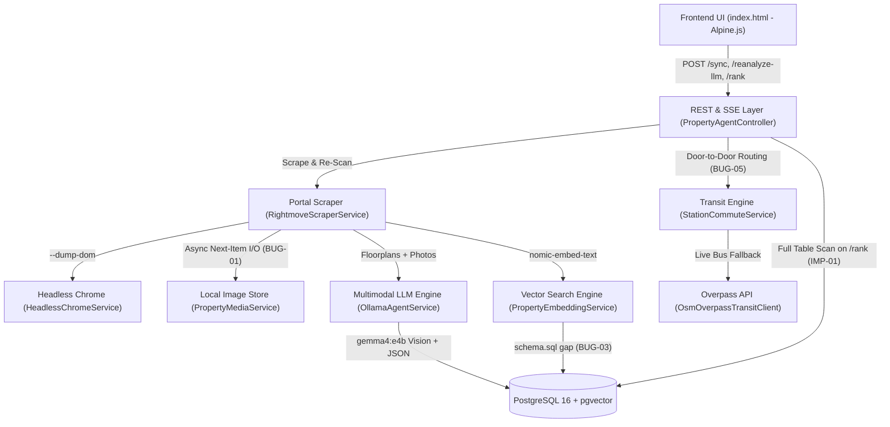

# Glasgow Property AI Agent — Deep-Dive Audit, Improvements & Feature Roadmap

## Executive Architecture & Risk Map

The application combines a headless Chrome / Jsoup portal scraper, local multimodal vision synthesis (`gemma4:e4b`), semantic chunk embeddings (`nomic-embed-text` + PostgreSQL `pgvector`), a zero-key Greater Glasgow multi-modal transit graph (115 ScotRail stations, 15 SPT Subway stops, and live OSM/NaPTAN bus data), and an Alpine.js reactive ranking UI.

> [!CAUTION]
> **Two Critical Data-Integrity Bugs Require Immediate Attention:** `BUG-01` can cross-contaminate photos, floorplans, and descriptions from one Rightmove property onto the next property whenever an intermediate listing is skipped; `BUG-02` causes **Re-Scan All / Re-Scan Failed** to invoke the OnTheMarket HTML parser against Rightmove URLs, overwriting gallery arrays and bathroom counts.

---

## Part 1: Verified Bugs & Defect Analysis

### Summary Matrix

| ID | Severity | Status | Component | Summary |
| :--- | :--- | :--- | :--- | :--- |
| **BUG-01** | Critical | Fixed | `RightmoveScraperService.java` | Pipelined `nextPrefetch` verified by `listingId` and forward-scanned for eligible items across Rightmove, OnTheMarket, and Re-Scan loops. |
| **BUG-02** | Critical | Fixed | `RightmoveScraperService.java` | `reanalyzeIndexedPropertiesWithLlm` prioritizes local disk media, routes `RM-*` URLs to `fetchRightmoveDetail`, and preserves thumbnails & `knownBathrooms`. |
| **BUG-03** | High | Fixed | `application.yml` & `PropertyEmbeddingService.java` | Enabled `spring.sql.init.mode: always` + `@PostConstruct ensureEmbeddingSchema()` + safe `property_embeddings` cleanup on `/clear`. |
| **BUG-04** | High | Fixed | `RightmoveScraperService.java` | Rightmove listings with `numberOfFloorplans == 0` now still fetch the detail page so full room-by-room descriptions are captured. |
| **BUG-05** | High | Fixed | `StationCommuteService.java` | `Train + Subway` mode now reports `combinedFreq` (bottleneck rail headway) and uses `bestStationDist` for rail access time. |
| **BUG-06** | Medium-High | Fixed | `RightmoveScraperService.java` | Dynamic Rightmove typeahead lookup (`los.rightmove.co.uk/typeahead`) + spatial corridor intersection for outer hubs and small-radius searches. |
| **BUG-07** | Medium | Fixed | `OllamaAgentService.java` | Added `"Converted"` and `"Attached"` to `garageType` JSON schema enum and aligned Stage 2 `think=false` progress logs. |
| **BUG-08** | Medium | Fixed | `PropertyAgentController.java` & `SearchFilterRequest.java` | Added explicit `bypassHardFilters` flag so clearing Panel 2 soft criteria keeps Panel 1 hard sidebar cutoffs active. |
| **BUG-09** | Medium | Fixed | `PropertyEmbeddingService.java` & `index.html` | Guarded `/embed-all` with single-flight `embeddingInProgress` + live progress polling, and reset all client caches on DB clear. |
| **BUG-10** | Medium | Fixed | `OllamaAgentService.java` & `PropertyEmbeddingService.java` | Added negation polarity handling (`"no electric heating"`, `"avoid conservatory"`, `"no onward chain"`), `"search_query: "` prefix on `findBestMatchForProperty`, and removed dead field. |
| **BUG-11** | Low-Medium | Fixed | `HeadlessChromeService.java` & `index.html` | Added `process.descendants()` cleanup on Windows Chrome timeouts, replaced `h-22` with `h-24`, and fixed Alpine `:key` bindings. |

---

### Detailed Root Causes & Fix Blueprints

#### BUG-01 [CRITICAL]: Cross-Listing Data & Image Contamination via `nextPrefetch`
- **Locations:** `RightmoveScraperService.java` lines 750–940 (`parseRightmoveNextDataPage`), lines 1424–1473 (`parseOnTheMarketNextDataPage`), and lines 1729–1778 (`reanalyzeIndexedPropertiesWithLlm`).
- **Root Cause:** While Ollama analyzes item `k`, `nextPrefetch` asynchronously fetches the detail page and downloads images for `items.get(k + 1)` into `data/property-images/RM-<id_{k+1}>/`. When the loop advances to `k + 1`, if that item hits **any** `continue` branch before line 846 — such as duplicate ID in corridor/job, `repository.existsById`, excluded property type (Flat/Terraced), `priceGbp <= 0` (POA), or `distFromTarget > maxRadiusMiles` (line 795) — `nextPrefetch` remains non-null. On iteration `k + 2`, `currentMedia = nextPrefetch.join()` consumes item `k + 1`'s `PreloadedMedia` without checking which listing it belongs to. Item `k + 2` is then analyzed and saved to PostgreSQL with item `k + 1`'s description, floorplans, and `/property-media/RM-<id_{k+1}>/...` URLs. Additionally, prefetching runs before radius/type checks, leaving orphan folders on disk for skipped listings.
- **Concrete Fix:**
  1. Add `String listingId` to `record PreloadedMedia(String listingId, DetailEnrichment detail, PropertyMediaService.DownloadedMediaBundle media)`.
  2. Verify `prefetched != null && listingId.equals(prefetched.listingId())` when consuming `nextPrefetch`; otherwise discard it.
  3. Extract a helper `findNextEligibleIndex(...)` that applies the exact same ID, DB-existence, property-type, price, and radius checks before scheduling `nextPrefetch`.

#### BUG-02 [CRITICAL]: `Re-Scan All` / `Re-Scan Failed` Runs OnTheMarket Parser Against Rightmove Listings
- **Location:** `RightmoveScraperService.java` lines 1730–1800 (`reanalyzeIndexedPropertiesWithLlm`).
- **Root Cause:** Lines 1731 and 1765 unconditionally call `fetchDetailEnrichment(entity.getRightmoveUrl(), entity.getThumbnailUrl())` even when `entity.getListingId()` starts with `RM-`. `fetchDetailEnrichment` (line 1624) uses plain Java `HttpClient` and parses OnTheMarket's `initialReduxState.property` JSON tree rather than Rightmove's `window.PAGE_MODEL` via `fetchRightmoveDetail`. Consequently:
  1. If local media already exists on disk, `downloadAllPropertyMedia` needlessly re-fetches 1 fallback thumbnail URL and overwrites `allImagesJson` unless `mediaService.loadExistingLocalMedia(listingId)` is checked **first**.
  2. Line 1796 (`entity.setThumbnailUrl(storedPhotos.get(0))`) overwrites the `400px` `photo-01-thumb.jpg` thumbnail path with full-size `photo-01.jpg`.
  3. Line 1792 (`assembleMetadata(extraction.metadata(), extraFeats, 1)`) hardcodes `knownBathrooms = 1`, clamping bathroom counts downward when LLM returns `null` or `0`.
- **Concrete Fix:**
  1. Check `mediaService.loadExistingLocalMedia(entity.getListingId())` **first** during re-analysis; only hit the network if local files are missing, and route `RM-*` URLs to `fetchRightmoveDetail(...)` vs `OTM-*` URLs to `fetchDetailEnrichment(...)`.
  2. Preserve `media.thumbnailWebUrl()` on `entity.setThumbnailUrl(...)`.
  3. Pass the previously stored bathroom count (from `entity.getMetadataJson()`, defaulting to `1`) into `assembleMetadata`.

#### BUG-03 [HIGH]: `property_embeddings` Table Missing on Clean PostgreSQL Deployments
- **Locations:** `src/main/resources/application.yml` (lines 24–27), `src/main/resources/schema.sql`, `PropertyAgentController.java` (line 387).
- **Root Cause:** Spring Boot 3 defaults `spring.sql.init.mode` to `embedded`, ignoring `schema.sql` for PostgreSQL. While Hibernate `ddl-auto: update` creates `indexed_properties` from `@Entity`, `property_embeddings` is accessed purely via `JdbcTemplate`. On any fresh Docker volume (`docker compose down -v` or new machine), `CREATE EXTENSION IF NOT EXISTS vector` and `CREATE TABLE IF NOT EXISTS property_embeddings` never execute — causing `/clear` (`DELETE FROM property_embeddings`) to throw HTTP `500` and silently breaking all vector embeddings.
- **Concrete Fix:** Add `spring.sql.init.mode: always` and `spring.jpa.defer-datasource-initialization: true` in `application.yml`, plus a defensive `@PostConstruct` initializer in `PropertyEmbeddingService.java`.

#### BUG-04 [HIGH]: Listings Without Floorplans Skip Full Description Extraction
- **Location:** `RightmoveScraperService.java` lines 859–864 and 922–926.
- **Root Cause:** `fetchRightmoveDetail(...)` is only called when `numberOfFloorplans > 0`. Estate agents in Scotland frequently upload floorplans a few days after initial listing or attach them inside the PDF Home Report. Skipping `fetchRightmoveDetail` leaves `rawDescription` with Rightmove's truncated ~250-character search summary card text, starving text LLM extraction, regex heuristics, EPC/heating parsing, and semantic search chunks of room dimensions and garden details.
- **Concrete Fix:** Always call `fetchRightmoveDetail(...)` for eligible listings (even when `numberOfFloorplans == 0`) so full `text.description` and `keyFeatures` are captured.

#### BUG-05 [HIGH]: `Train + Subway` Transfer Frequency & Access Distance Calculation Errors
- **Location:** `StationCommuteService.java` lines 735–754.
- **Root Cause:**
  1. Line 742 computes `combinedFreq` (with an artificial `Math.max(4, ...)` floor), and **line 749 passes `subwayFreq` (`15`) instead of `combinedFreq`** into `new ModeOption(...)`. A property served by a 2-trains/hr suburban halt transferring to the Subway reports `servicesPerHourPeak = 15` and bypasses the user's `Min Peak Frequency` hard cutoff.
  2. Line 735 calculates `railAccessMins` from `entity.getDistanceToStationMiles()` (distance to the default nearest halt) instead of the actual distance from `(lat, lon)` to `nearestRail` (`bestRailCandidate.station`, which may be up to 3.5 miles away).
- **Concrete Fix:** Compute `combinedFreq = Math.min(subwayFreq, nearestRail.trainsPerHourPeak())`, pass `combinedFreq` into `ModeOption`, and compute `railAccessMins` using Haversine distance to `nearestRail`.

#### BUG-06 [MEDIUM-HIGH]: Static 5-Region Rightmove Corridors Miss Outer Stations & Small Radii
- **Location:** `RightmoveScraperService.java` lines 536–542.
- **Root Cause:** Rightmove scraping always iterates over 5 fixed `REGION^` identifiers (`Glasgow`, `East Renfrewshire`, `South Lanarkshire`, `East Dunbartonshire`, `Paisley`), ignoring `centerLocation` (`application.yml`'s `default-location-identifier` is also unused). Meanwhile, `StationCommuteService` supports 115 stations including North Lanarkshire (`Croy`, `Motherwell`, `Coatbridge`), West Dunbartonshire / Argyll (`Dumbarton`, `Balloch`, `Helensburgh`), Inverclyde (`Greenock`, `Gourock`, `Wemyss Bay`), and Ayrshire (`Kilwinning`, `Irvine`, `Troon`, `Ayr`). Furthermore, passing `radius=3.0` on a `REGION^` centred 8 miles away from the user's chosen station discards valid properties before `parseRightmoveNextDataPage` ever sees them.
- **Concrete Fix:** Map commuter corridors / target hubs dynamically to appropriate Rightmove `REGION^` / `STATION^` / `OUTCODE^` identifiers, and only query corridors whose bounding circle intersects `(targetLat, targetLon, radiusMiles)`.

#### BUG-07 [MEDIUM]: Structured Output JSON Schema Drops `"Converted"` & `"Attached"` Garages
- **Location:** `OllamaAgentService.java` line 965.
- **Root Cause:** `ExtractedPropertyMetadata.java` (line 20) and `heuristicExtract` (line 1625) model `"Integral"`, `"Detached"`, `"Converted"`, `"Attached"`, and `"None"`, whereas `metadataJsonSchema()` restricts `garageType` to `List.of("Integral", "Detached", "None")`. Because Ollama enforces grammar-guided generation from `format`, `gemma4:e4b` cannot emit `"Converted"` (common in Scottish 1980s/90s detached villas). Also, log messages at lines 493 and 899 claim `think=true` on Stage 2 synthesis when line 835 sets `think: false`.
- **Concrete Fix:** Update the `garageType` schema enum to `List.of("Integral", "Detached", "Attached", "Converted", "None")` and align the Stage 2 log text with `think=false`.

#### BUG-08 [MEDIUM]: Clearing Dynamic Criteria Disables Hard Sidebar Cutoffs
- **Location:** `PropertyAgentController.java` lines 423–432 and 481–482.
- **Root Cause:** `boolean showAllInDb = (criteriaCount == 0)` short-circuits `radiusMiles`, `maxPrice`, `minBedrooms`, `requireFreeStationParking`, `requireStepFreeCategoryA`, `maxDoorToCentralCommuteMins`, and `minServicesPerHour`. If a buyer clears Panel 2's soft layout chips so they can browse purely by commute time and budget in Panel 1, adjusting Panel 1 sliders has no effect until at least one Panel 2 chip is re-added.
- **Concrete Fix:** Always enforce Panel 1's hard filters during `/rank`; when `criteriaCount == 0`, award neutral layout points while keeping hard budget/commute/radius filters active (with an explicit `"Show Entire DB"` toggle if needed).

#### BUG-09 [MEDIUM]: Unsynchronized `/embed-all`, Fake 4-Second UI Timer & Incomplete Client Reset
- **Locations:** `PropertyAgentController.java` lines 524–537, `index.html` lines 977–988 and 1476–1509.
- **Root Cause:**
  1. `POST /api/properties/embed-all` fires `CompletableFuture.runAsync(...)` without checking whether an embedding batch or `/clear` is already running.
  2. `triggerEmbedAll()` in `index.html` resets `this.embeddingInProgress = false` inside `setTimeout(..., 4000)` even when embedding 150 properties takes 45+ seconds.
  3. `clearDatabase()` in `index.html` leaves `commuteReports`, `semanticResults`, `semanticQuery`, and `embeddingStats` populated with deleted property state.
- **Concrete Fix:** Guard `embedAllProperties` with an `AtomicBoolean embeddingRunning` + maintenance lock check, expose `embeddingRunning` in `/embedding-stats`, poll until completion, and reset all client caches inside `clearDatabase()`.

#### BUG-10 [MEDIUM]: Custom Rule Negation Blindness & Missing Query Embedding Prefix
- **Locations:** `OllamaAgentService.java` lines 1510–1529, `PropertyEmbeddingService.java` lines 347–349.
- **Root Cause:**
  1. `checkCustomRule` strips punctuation and checks if 60% of words appear in `combined`. Negative rules such as `"no electric heating"` or `"avoid conservatory"` drop `"no"` (`kw.length() > 2`) and match `"electric"` + `"heating"` at `100%`, rewarding the unwanted attribute.
  2. `findBestMatchForProperty` (line 348) calls `generateEmbedding(query)` instead of `generateQueryEmbedding(query)` when `precomputedQueryVec == null`, omitting `"search_query: "`. (`ruleEmbeddingCache` at `OllamaAgentService.java:58` is also unused dead code.)
- **Concrete Fix:** Detect negation prefixes (`no `, `not `, `without `, `avoid `, `exclude `) in `evaluateSingleCriterion` to invert polarity, and switch line 348 to `generateQueryEmbedding(query)`.

#### BUG-11 [LOW-MEDIUM]: Windows Zombie Chrome Processes & Minor Frontend Defects
- **Locations:** `HeadlessChromeService.java` lines 96–100, `index.html` lines 570 and 707–717.
- **Root Cause:**
  1. On Windows, `process.destroyForcibly()` kills only the root `chrome.exe` wrapper process, leaving `--type=renderer` and `--type=gpu-process` children alive when a page load times out.
  2. `index.html` line 570 uses `h-22` (not a valid Tailwind v3 utility class), and lines 707/716 bind `:key="m"` on criteria strings without index disambiguation.
- **Concrete Fix:** Kill `process.descendants().forEach(ProcessHandle::destroyForcibly)` before `process.destroyForcibly()`, replace `h-22` with `h-24`, and use `(m, mIdx)` for `:key`.

---

## Part 2: Architectural, Performance & AI Quality Improvements

### IMP-01: Lightweight Projection & SQL Pushdown for `/api/properties/rank`
- **Problem:** Every slider change in `PropertyAgentController.filterAndRank` executes `repository.findAll()`, pulling `rawDescription` (up to 8 KB) and `llmResponseLog` (20–40 KB of multimodal transcripts per row) across JDBC for every property in PostgreSQL even though `llmResponseLog` is only needed on `/detail`.
- **Solution:** Create a Spring Data projection (`PropertySummaryProjection`) excluding `llmResponseLog` and push `priceGbp`, `bedrooms`, and `propertyType` predicates into SQL `WHERE` clauses backed by composite indexes.

### IMP-02: Persistent Browser Context (Playwright / CDP) Instead of Cold-Spawning `chrome.exe`
- **Problem:** `HeadlessChromeService` cold-launches a new OS process (`chrome.exe --headless=new --dump-dom`) per search page and per detail page (~2.5–4.5s process startup overhead each).
- **Solution:** Reuse a warm headless browser context via Chrome DevTools Protocol or `playwright-java` and block third-party analytics/ad requests for a **3–5x scrape speedup**.

### IMP-03: Dual-Resolution Vision Encoding for `gemma4:e4b` (High-Res Floorplans vs. Standard Photos)
- **Problem:** `OllamaAgentService` downscales both floorplans and interior photos to `1024px` (`0.82` JPEG). Floorplan text (`WC 1.8m x 0.9m`, `Study 2.4m x 2.1m`) blurs at `1024px`.
- **Solution:** Encode floorplans at `1680px` (PNG or `0.94` JPEG with mild sharpening) while keeping interior photos at `896px` (`0.82` JPEG), and batch 2–3 gallery photos per multimodal turn to avoid repeated system-prompt KV prefill overhead.

### IMP-04: Decouple "Portal Scrape Scope" from "Live Ranking Sliders"
- **Problem:** Panel 1 sliders simultaneously define scrape parameters and live local filtering. Widening `Max Price` after a narrower scrape creates silent coverage gaps.
- **Solution:** Track the indexed dataset's scrape envelope (`scrapedMaxPrice`, `scrapedMinBeds`, `scrapedTypes`, `scrapedRadius`) and display a prompt banner when live sliders exceed the scraped range.

### IMP-05: Incremental Delta-Sync (Price Reductions & Sold/SSTC Tracking Without Re-Running Vision)
- **Problem:** Existing `RM-*` IDs are skipped via N+1 `existsById(listingId)` checks, missing asking-price reductions (`Offers Over` drops or switches to `Fixed Price`).
- **Solution:** Preload a `Map<String, PriceSnapshot>` at job start; if a search card shows a new `priceGbp` or `priceQualifier`, update `previousPriceGbp`, `priceGbp`, `priceChangedAt`, and `lastSeenAt` immediately without re-running `gemma4:e4b`.

### IMP-06: Hybrid BM25 + Vector + Polarity Scoring for Custom Criteria
- **Problem:** Pure cosine similarity misses exact tokens (`"EPC B"`, `"G61"`, `"gas central heating"`), while substring fallback lacks semantic nuance.
- **Solution:** Combine PostgreSQL `tsvector` full-text search + `pgvector` cosine similarity via Reciprocal Rank Fusion (RRF) with negation polarity detection.

### IMP-07: Automated Integration & Regression Test Suite
- **Problem:** No unit or integration tests currently guard Rightmove/OTM JSON parsing, `StationCommuteService` multi-modal routing, or controller filter logic.
- **Solution:** Add JUnit 5 fixture tests for `PAGE_MODEL` / `__NEXT_DATA__`, golden transit route assertions, and Testcontainers `pgvector` tests.

---

## Part 3: High-Value New Features Roadmap (Greater Glasgow & Scotland)

1. **FEAT-01 — Scottish "Offers Over" + Home Report Cash & LBTT Calculator:** Model Scottish closing premiums above Offers Over (e.g., +12% in East Renfrewshire / Bearsden vs. 0% Fixed Price), Home Report LTV caps (cash required above HR valuation), and tiered Scottish **LBTT** (including First-Time Buyer relief & Additional Dwelling Supplement).
2. **FEAT-02 — Interactive Greater Glasgow Rail, Subway & Score Map View:** Zero-key Leaflet / MapLibre split-screen map plotting scored property pins (`0–100`), all 115 ScotRail stations, the 15 SPT Subway circle stops, and clickable route lines.
3. **FEAT-03 — Scottish School Catchment & Attainment Overlay:** Offline GeoJSON polygon lookup for Primary & Secondary (Non-Denominational & Denominational) school catchments (*Williamwood*, *Mearns Castle*, *St Ninian's*, *Bearsden*, *Douglas*, *Jordanhill*, etc.) + attainment rankings.
4. **FEAT-04 — Dual-Commuter Household Mode:** Simultaneously optimize door-to-door transit for Partner A (e.g., *Glasgow Central*) and Partner B (e.g., *QEUH Hospital*, *Glasgow Uni / Hillhead*, or *Edinburgh Waverley*).
5. **FEAT-05 — Buyer Shortlist, Viewing Tracker, Dislike/Hide & Side-by-Side Comparison:** Persistent `⭐ Shortlist`, `👁️ Hide/Dismiss`, viewing notes, and a 2–4 property side-by-side floorplan + commute comparison drawer.
6. **FEAT-06 — Scottish Home Report PDF Dropzone & Deep Parser:** Drag-and-drop Home Report PDF extraction (`PDFBox` + `gemma4:e4b`) for exact Home Report Valuation (£), internal floor area ($\text{m}^2$) for true **£/$\text{m}^2$** value scoring, Council Tax Band (A–H), and Category 2/3 survey repair warnings.
7. **FEAT-07 — Offline SIMD Neighbourhood Profile & Flood / Noise Indicators:** Local Scottish Index of Multiple Deprivation (SIMD) decile lookup (`1–10`) + SEPA flood-risk and postcode sector median price benchmarks.

---

## Implementation Status & Roadmap Phases

1. **✅ Phase 1 — Stability & Data Integrity (Completed & Verified):** Fixed all 11 bugs (`BUG-01` through `BUG-11`), including `listingId`-verified `nextPrefetch` media isolation, local-disk-first Rightmove/OTM `Re-Scan` routing, `property_embeddings` startup initialization, unconditional Rightmove detail description extraction, `Train + Subway` bottleneck frequency/distance, dynamic Rightmove outer-station corridor typeahead, `"Converted"`/`"Attached"` garage schema enums, explicit `bypassHardFilters` control, `/embed-all` concurrency lock + real progress counters, negated custom rule evaluation, and `descendants()` Chrome process cleanup (`Phase1BugFixesRegressionTest`).
2. **✅ Phase 2 — Throughput, Performance & Multimodal Precision (Completed & Verified):** Implemented all 7 architectural & AI improvements (`IMP-01` through `IMP-07`), including lightweight `/rank` & `/suggestions` SQL projections excluding `llm_response_log`, persistent warm Headless Chrome CDP daemon (`WebSocket` + `--blink-settings=imagesEnabled=false`), dual-resolution `gemma4:e4b` vision encoding (`1680px` lossless PNG floorplans + `896px` JPEG 4-photo batches + compact `-thumb.jpg` card thumbnails), UI scrape-scope envelope detection, zero-N+1 `ListingPriceSnapshot` preloading with cumulative asking-price reduction & `Fixed Price` delta sync, hybrid `pgvector` + PostgreSQL `tsvector` (`ts_rank_cd` / `websearch_to_tsquery`) search, and automated JUnit 5 regression coverage (`Phase2ImprovementsTest`).
3. **✅ Phase 2.5 — Refactoring, Simplification & Tech Upgrades (Completed & Verified):** Upgraded to Spring Boot `4.1.2` + Java `25` + Jackson 3 + PostgreSQL `17` (`pgvector 0.8.7`) + Flyway `12.4` (`V1`/`V2` migrations), added TwelveMonkeys WebP `ImageIO` decoding, decomposed `RightmoveScraperService` and `OllamaAgentService` into focused single-responsibility services (`RightmovePortalClient`, `OnTheMarketPortalClient`, `PropertyIngestionPipeline`, `ScrapeJobStateTracker` with event-driven SSE, `OllamaApiClient`, `VisionImagePreprocessor`, `HeuristicMetadataExtractor`, `PropertyScoringEngine`), externalized `glasgow-transit-network.json`, modularized `index.html` into `static/js/*.js` + `20.5 KB` precompiled `tailwind.min.css`, and verified via `Phase25RefactoringAndUpgradesTest` (see `REFACTORING_AND_UPGRADES.md`).
4. **✅ Phase 3 — Glasgow Buyer Power Tools (Completed & Verified):** Implemented all 7 Greater Glasgow & Scottish buyer features (`FEAT-01` through `FEAT-07`), including the Revenue Scotland LBTT / First-Time Buyer relief / 8% ADS + Home Report LTV & upfront cash calculator (`ScottishOfferAndLbttService`), zero-API-key offline interactive HTML5 Canvas Rail, SPT Subway, School Catchment & Score Map (`static/js/map.js` + `/transit-map-data`), 35-corridor Scottish Non-Denominational & Denominational Secondary School Catchment + Attainment Tier + SIMD Decile overlay (`GlasgowSchoolAndAreaService` + `glasgow-schools-and-areas.json`), Dual-Commuter Household Mode ("Partner A + Partner B" worst-leg & combined-commute scoring), PostgreSQL-backed Buyer Shortlist / Hide / Viewing Status & Notes + 2–4 Home Side-by-Side Comparison Matrix (`V3__phase3_buyer_workflow_and_home_report.sql` + `BuyerWorkflowService`), and Scottish Home Report PDF `FlateDecode` / RICS Single Survey inspector with Section 4 Market Valuation (£), internal floor area ($\text{m}^2$), £/$\text{m}^2$, Council Tax Band, EPC Band, and Category 2/3 repair warnings (`HomeReportAnalyzerService`), verified end-to-end in `Phase3FeaturesTest`.
